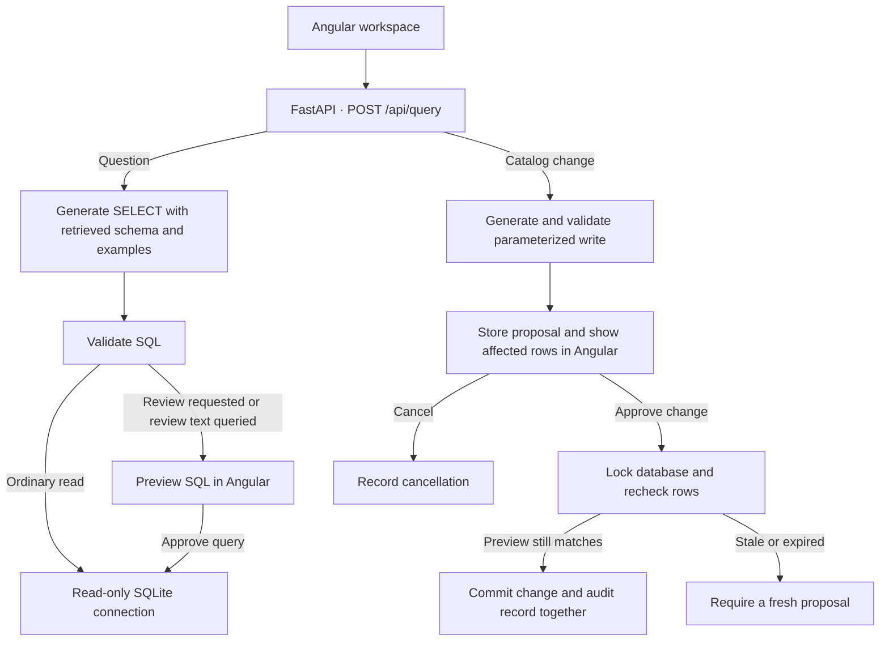

# Query Studio

Query Studio turns plain-English questions about Olist’s Brazilian marketplace into SQLite queries. Ask *Which customer state had the most distinct orders?* and you can inspect the generated SQL, copy it, and check the result against the data. A separate workflow lets you preview and approve changes to the local product and seller catalogs.

## Example questions

| Ask the app | Expected result on the full Olist dataset |
| --- | --- |
| How many distinct orders were placed? | 99,441 orders |
| What was the total merchandise revenue in BRL? | R$ 13,591,643.70 |
| Which customer state had the most distinct orders? | SP (São Paulo), 41,746 orders |

These figures include all order statuses. An order can contain several of the dataset’s 112,650 items. Merchandise revenue sums item prices in Brazilian reais and excludes freight.

## Run locally on Windows

Open the repository in VS Code. Run each PowerShell block from the repository root. The tested toolchain is Python 3.13.17, Node.js 26.13.1, npm 11.20.0, and Angular 22.3.0. Exact package versions are recorded in the [Python requirements](requirements.txt) and [frontend lockfile](frontend/package-lock.json).

### 1. Install dependencies

```powershell
py -3.13 --version
py -3.13 -m venv .venv
.\.venv\Scripts\python.exe -m pip install -r requirements.txt
npm.cmd --prefix frontend ci
```

### 2. Configure OpenAI

```powershell
if (-not (Test-Path .env)) { Copy-Item .env.example .env }
code .env
```

Set these values in the root `.env` and restart FastAPI if it is already running.

```dotenv
OPENAI_API_KEY=your-openai-api-key
OPENAI_MODEL=gpt-6.2-sol
EMBEDDING_MODEL=text-embedding-3-small
```

The backend needs an API key with model access to translate any plain-English request, including reads and proposed writes. Building the schema index also uses the key. You can seed SQLite, browse the schema, and run the automated tests offline. Keep the key in your local `.env`.

### 3. Import the Olist dataset

If the CSVs are already in `data/raw/`, skip the download. Otherwise, sign in to Kaggle, open the dataset page, select **Download**, and extract the ZIP directly into `data/raw/`. [Brazilian E-Commerce Public Dataset by Olist](https://www.kaggle.com/datasets/olistbr/brazilian-ecommerce)

<details>
<summary>PowerShell download and expected filenames</summary>

```powershell
New-Item -ItemType Directory -Force data\raw | Out-Null
$archive = Join-Path $env:TEMP ('olist-' + [guid]::NewGuid() + '.zip')
curl.exe -fL --retry 2 'https://www.kaggle.com/api/v1/datasets/download/olistbr/brazilian-ecommerce' -o $archive
if ($LASTEXITCODE -eq 0) { Expand-Archive -LiteralPath $archive -DestinationPath data\raw }
```

The importer needs these seven files. Add `product_category_name_translation.csv` for English category names.

```text
olist_orders_dataset.csv
olist_order_items_dataset.csv
olist_customers_dataset.csv
olist_products_dataset.csv
olist_sellers_dataset.csv
olist_geolocation_dataset.csv
olist_order_reviews_dataset.csv
```

</details>

```powershell
.\.venv\Scripts\python.exe -m data.seed
```

Seeding rebuilds the six analytical tables from the CSVs. Reseeding replaces local catalog edits and preserves the separate query log.

### 4. Build the schema index (optional)

```powershell
.\.venv\Scripts\python.exe -m agent.build_index
```

Chroma stores embeddings of table descriptions, columns, and join keys in `chroma_store/`. If the matching index is missing or incomplete, the backend supplies the full schema to the SQL model. Check `GET /api/health` for the active retrieval mode.

### 5. Start the app

**Terminal 1 · FastAPI**

```powershell
.\.venv\Scripts\python.exe -m uvicorn api.main:app --host 127.0.0.1 --port 8000 --reload --reload-include .env
```

**Terminal 2 · Angular**

```powershell
npm.cmd --prefix frontend start
```

Open **Schema explorer** to see the available tables and joins. In **Query workspace**, enter an example question and select **Run query** to see the SQL and paginated results. The API docs include request and response formats for all four routes. [Open Query Studio](http://localhost:4200) · [FastAPI docs](http://127.0.0.1:8000/docs)

## Preview a catalog change

Select **Propose a change**, enter *Add a new product with ID demo-book-01, category books, and 2 photos*, and select **Preview change**. The dialog shows the target table, SQL, bound values, and affected rows. Inserts show new rows, updates show before and after values, and deletes show rows to remove. Choose **Cancel** to leave the catalog as it is, or **Approve change** to apply the proposal.

| Editable table | ID required for inserts | Editable columns |
| --- | --- | --- |
| `dim_products` | `product_id` | `category_name`, `photos_qty` |
| `dim_sellers` | `seller_id` | `city`, `state`, `zip_prefix` |

Each proposal covers one statement and **1–10 rows**, and expires after **10 minutes**. Updates and deletes require equality filters. Approval locks the database and rechecks the preview. If a row has changed, request a fresh preview. Each proposal can be applied once.

## Architecture

Angular calls FastAPI through its local `/api` proxy. LangChain sends the question and schema context to OpenAI for SQL generation. SQLite executes the validated SQL locally.



Business data lives in `data/olist.db`. Query history and pending proposals live in `data/studio.db`. For either approval flow, Angular sends only the stored request ID and decision to `POST /api/approve`. Analytical reads have a three-second execution budget and return up to 200 rows.

### Analytical schema

| Table | What one row represents | Join key or usage |
| --- | --- | --- |
| `fact_orders` | One order item, or a placeholder with `item_seq = 0` for an order without items | Keyed by `(order_id, item_seq)`. Count distinct `order_id` for orders. Monetary amounts are stored in BRL cents. |
| `dim_users` | One customer record | Join on `user_id`. Use `unique_customer_id` for repeat buyers. |
| `dim_products` | One product | Join on `product_id` for category and photo count. |
| `dim_sellers` | One seller | Join on `seller_id` for city and state. |
| `dim_geography` | One postal prefix with averaged coordinates | Join customers or sellers on `zip_prefix`. |
| `dim_reviews` | One source review | Aggregate items and reviews separately by `order_id` before joining to avoid double-counting. |

## Testing

```powershell
$testRoot = Join-Path $env:TEMP ('olist-tests-' + [guid]::NewGuid())
.\.venv\Scripts\python.exe -m pytest -q --basetemp $testRoot
.\.venv\Scripts\python.exe -m pip check
npm.cmd --prefix frontend test -- --watch=false
npm.cmd --prefix frontend run build
```

The offline suite uses model doubles and temporary SQLite databases for write tests. The approval test checks the stored value during preview, after cancellation, after approval, and after retrying the same approval. The example results above were checked against the full dataset with independent SQL. Live model output depends on your configured OpenAI account and model. [Backend tests](tests) · [Write approval tests](tests/test_write_proposals.py)

## Dataset attribution

Olist published the **Brazilian E-Commerce Public Dataset by Olist** under CC BY-NC-SA 4.0. Query Studio reshapes the source CSVs into analytical tables, averages coordinates by postal prefix, and calculates merchandise totals. [Original dataset](https://www.kaggle.com/datasets/olistbr/brazilian-ecommerce) · [Dataset license](https://creativecommons.org/licenses/by-nc-sa/4.0/)
