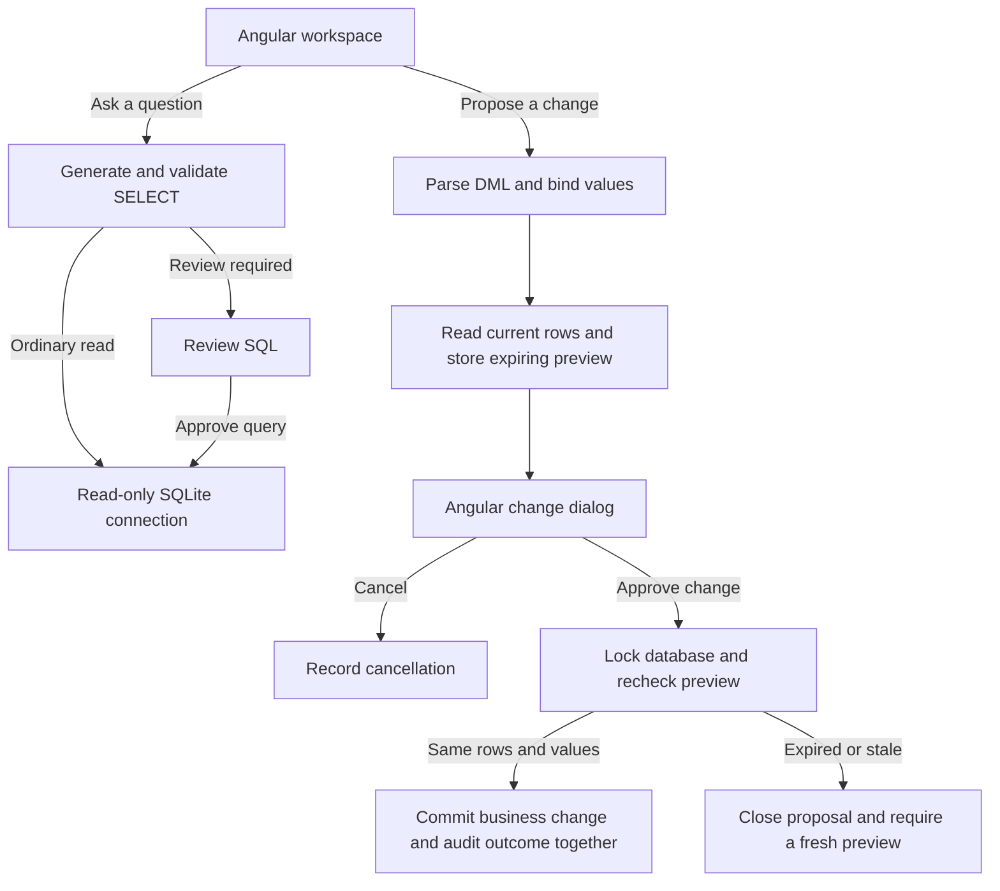

# Query Studio

Ask a question about Olist’s Brazilian marketplace, read the generated SQLite query, and explore its results. To edit the local product or seller catalog, describe a change in plain English, inspect the affected rows, and approve or cancel it in Angular.

## Run on Windows

Open this folder in VS Code. Each terminal below uses PowerShell and starts at the repository root. These commands use the virtual environment’s Python directly, so activation and changes to your PowerShell execution policy are optional.

### 1. Install the tested toolchain and packages

With Python 3.13.17, Node 26.13.1 and npm 11.20.0 installed, run the following. The project uses the Angular CLI version in its lockfile.

```powershell
Set-Location D:\text-to-sql
py -3.13 --version
node --version
npm.cmd --version
py -3.13 -m venv .venv
.\.venv\Scripts\python.exe -m pip install -r requirements.txt
npm.cmd --prefix frontend ci
```

If VS Code cannot find an installed Node, inspect the paths below. For the standard machine installation, the last line adds Node to the current terminal. Reopen VS Code after changing the permanent Windows PATH.

```powershell
Get-Command node,npm.cmd -ErrorAction SilentlyContinue
[Environment]::GetEnvironmentVariable('Path','User')
[Environment]::GetEnvironmentVariable('Path','Machine')
if (Test-Path 'C:\Program Files\nodejs\node.exe') { $env:Path = "C:\Program Files\nodejs;$env:Path" }
```

### 2. Configure the backend

```powershell
if (-not (Test-Path .env)) { Copy-Item .env.example .env }
code .env
```

Set `OPENAI_API_KEY` to your own key in that file and save it. Keep `OPENAI_MODEL=gpt-6.2-sol` and `EMBEDDING_MODEL=text-embedding-3-small`. You need API access to both models to use indexed retrieval. The key stays in the backend environment. Generation sends the question, schema context, and worked examples to OpenAI. Indexing sends the schema documents. Query results stay local. [SQL generation model](https://developers.openai.com/api/docs/models/gpt-6.2-sol) · [Embedding model](https://developers.openai.com/api/docs/models/text-embedding-3-small)

### 3. Get the data and seed SQLite

If your extracted CSV files are already in `data\raw\`, go straight to the seed command. Otherwise, use the public Kaggle download. The archive contains a payments file which the importer does not require.

```powershell
New-Item -ItemType Directory -Force data\raw | Out-Null
$archive = Join-Path $env:TEMP ('olist-' + [guid]::NewGuid() + '.zip')
curl.exe -fL --retry 2 'https://www.kaggle.com/api/v1/datasets/download/olistbr/brazilian-ecommerce' -o $archive
if ($LASTEXITCODE -eq 0) { Expand-Archive -LiteralPath $archive -DestinationPath data\raw }
```

If the public download asks for authentication, sign in to Kaggle in your browser, open the dataset page, select **Download**, and save the ZIP. Extract its CSV files directly into `data\raw\`. [Kaggle dataset and download](https://www.kaggle.com/datasets/olistbr/brazilian-ecommerce)

| Required CSV in `data/raw/` | Contents |
| --- | --- |
| `olist_orders_dataset.csv` | Order headers |
| `olist_order_items_dataset.csv` | Individual items, prices, and freight |
| `olist_customers_dataset.csv` | Customer identifiers and locations |
| `olist_products_dataset.csv` | Product catalog |
| `olist_sellers_dataset.csv` | Merchants |
| `olist_geolocation_dataset.csv` | Postal-prefix coordinates |
| `olist_order_reviews_dataset.csv` | Customer reviews |

Include `product_category_name_translation.csv` for English category names. The importer retains Portuguese names where a translation is unavailable.

```powershell
.\.venv\Scripts\python.exe -m data.seed
```

Seeding refreshes all six analytical tables in one transaction. A failed import rolls back. A second successful run produces the same totals. The query log lives in a separate file and survives reseeding.

### 4. Build the schema index

```powershell
.\.venv\Scripts\python.exe -m agent.build_index
```

The builder embeds one document per table, including its columns, grain, and join keys. Chroma persists the collection in `chroma_store\`. Its name incorporates the schema and embedding model, so re-running with the same inputs updates the six documents. A missing or incomplete matching collection activates `full_schema` mode. In that mode the model receives the entire data dictionary. Both modes need a key for live SQL generation. You can browse the schema and run the offline tests before adding a key.

### 5. Start both servers

**Terminal 1 — FastAPI** (from the repository root)

```powershell
.\.venv\Scripts\python.exe -m uvicorn api.main:app --host 127.0.0.1 --port 8000 --reload --reload-include .env
```

**Terminal 2 — Angular** (from the repository root)

```powershell
npm.cmd --prefix frontend start
```

Open the workspace, choose **Schema explorer**, and expand `fact_orders`. Return to **Query workspace**, select a suggested question, and click **Run query**. Select **Review SQL first** to inspect a statement before it runs. Queries that read customer review text automatically require review. Use **Approve query** or **Cancel** in the dialog. Each question has its own result in the current page’s history. [Workspace](http://localhost:4200) · [FastAPI interactive docs](http://127.0.0.1:8000/docs)

## Preview a catalog change

Choose **Propose a change** and enter *Add a new product with ID demo-book-01, category books, and 2 photos.* Click **Preview change**. The dialog shows the operation, target table, SQL, bound values, affected-row count, and proposed row. Choose **Cancel** to discard the proposal or **Approve change** to apply it to your local database. For an existing product, try *Change product demo-book-01's category to fiction* or *Delete product demo-book-01*. Updates show the before and after values side by side. Deletes show the rows to be removed.

| Editable table | Primary key | Editable attributes |
| --- | --- | --- |
| `dim_products` | `product_id` | `category_name`, `photos_qty` |
| `dim_sellers` | `seller_id` | `city`, `state`, `zip_prefix` |

Start with an action such as *add*, *change*, or *remove* and name a product or seller. Each proposal contains **one statement affecting 1–10 rows** and expires after **10 minutes**. Inserts supply a unique key for each row. Updates and deletes require equality filters on allowed columns, optionally joined by `AND`. Primary keys stay fixed on updates. Foreign keys protect products and sellers referenced by orders. Reseeding refreshes the catalog from the CSVs and replaces local edits.

## Example questions and verified results

These values come from the full public Olist dataset with all order statuses included. Merchandise revenue sums item prices and excludes freight. Money is stored as integer BRL cents and presented in reais.

| Question | Expected result |
| --- | --- |
| How many distinct orders were placed? | 99,441 |
| What was the total merchandise revenue in BRL? | R$ 13,591,643.70 |
| Which customer state had the most distinct orders? | SP, 41,746 orders |

The source contains 112,650 items. Purchases with multiple items count once in an order count. Orders with no items contribute zero revenue. These results were checked with independent SQL and a deterministic model double. Live OpenAI generation and embeddings require your configured key.

## Architecture and data model

The browser calls relative `/api/**` URLs through Angular’s local proxy. Analytical questions use schema retrieval, worked examples, and a read-only connection. An explicit change request uses the target table's schema and a restricted SQL grammar. Both paths use the configured OpenAI model through LangChain.



| Table | Grain and join |
| --- | --- |
| `fact_orders` | One item per `(order_id, item_seq)`. Sequence zero preserves orders without items. Join customers, products and sellers on their respective IDs. |
| `dim_users` | One source customer record per `user_id`. Use `unique_customer_id` for repeat buyers. |
| `dim_products` | One SKU per `product_id`, with category and photo count. |
| `dim_sellers` | One seller per `seller_id`, with the merchant’s city and state. |
| `dim_geography` | One mean coordinate pair per `zip_prefix`. Left join to customers or sellers to retain missing locations. |
| `dim_reviews` | One source review row. An order can have multiple items and reviews. Aggregate both sides to order grain before joining on `order_id`. |

Analytical queries use a SQLite connection with `mode=ro`, `query_only`, and an authorizer that restricts tables and functions. SQLite prepares a single statement before review. Read execution has a three-second budget and returns up to 200 rows. The UI pages through ten rows at a time.

| Route | Purpose |
| --- | --- |
| `GET /api/health` | Backend liveness, local database presence, key presence, and index mode. Key presence is a configuration check. |
| `GET /api/schema` | Table names, column descriptions, units, and join keys. |
| `POST /api/query` | Defaults to `intent: "read"`. For a proposal, send `{"intent":"change","question":"Change product p1's category to books."}`. A pending write includes its request ID, SQL, and a `change` object containing parameters, operation, table, before/after rows, count, and expiry. |
| `POST /api/approve` | Accepts a stored `request_id` and a `decision` of `approve` or `cancel`. Each pending request can be resolved once. |

The local application log in `data/studio.db` stores the question, SQL, retrieval details, latency, and outcome. Its `write_proposal` table stores the bindings and preview under the same request ID. The browser sends only that ID and the decision. For a write approval, a dedicated SQLite connection opens `olist.db`, attaches `studio.db`, and takes a write lock with `BEGIN IMMEDIATE`. It checks expiry and the entire ordered preview again, executes the stored statement, verifies the affected count and resulting rows, and commits the audit outcome with the business change. Both files use SQLite rollback journals for atomic multi-file commits. A stale or expired proposal requires a fresh preview. Repeated decisions receive HTTP 409.

## Verification

Run from the root. The unique temporary directory gives each backend test run its own writable location on Windows.

```powershell
$testRoot = Join-Path $env:TEMP ('olist-tests-' + [guid]::NewGuid())
.\.venv\Scripts\python.exe -m pytest -q --basetemp $testRoot
.\.venv\Scripts\python.exe -m pip check
npm.cmd --prefix frontend test -- --watch=false
npm.cmd --prefix frontend run build
```

The backend suite creates a synthetic three-order CSV fixture. All write tests use temporary business and log databases. They cover inserts, updates, deletes, cancellation, competing approvals, expiry, stale previews, row limits, and rollback when auditing fails. Read tests cover seeding, empty results, read limits, exceptional reads, and schema retrieval. Full-data comparisons open the local Olist database for reads only. A headless Edge run used a generation double and temporary SQLite files to verify the original value while the dialog was open, cancellation, a fresh approval, a subsequent SELECT, and HTTP 409 on replay.

| Tested component | Version |
| --- | --- |
| Python / SQLite | 3.13.17 / 3.50.4 |
| FastAPI / Uvicorn | 0.165.0 / 0.54.0 |
| SQLAlchemy / ChromaDB | 2.1.9 / 1.5.9 |
| LangChain Core / LangChain OpenAI | 1.8.3 / 1.8.3 |
| OpenAI Python | 3.55.1 |
| Node / npm | 26.13.1 / 11.20.0 |
| Angular / Angular CLI | 22.3.0 / 22.3.0 |
| TypeScript / Vitest | 6.0.3 / 5.1.1 |

The complete Python environment is pinned in `requirements.txt`. The frontend uses `frontend/package-lock.json`. Angular includes bundled third-party notices in `frontend/dist/frontend/3rdpartylicenses.txt` after a production build.

## Data attribution

Olist provided the **Brazilian E-Commerce Public Dataset by Olist** under Creative Commons Attribution-NonCommercial-ShareAlike 4.0. Query Studio transforms the local copy into an analytical schema, aggregates geolocation observations, and calculates merchandise totals. Raw data, derived databases, indexes, and credentials are excluded from Git. [Dataset and original attribution](https://www.kaggle.com/datasets/olistbr/brazilian-ecommerce) · [CC BY-NC-SA 4.0 license](https://creativecommons.org/licenses/by-nc-sa/4.0/)
